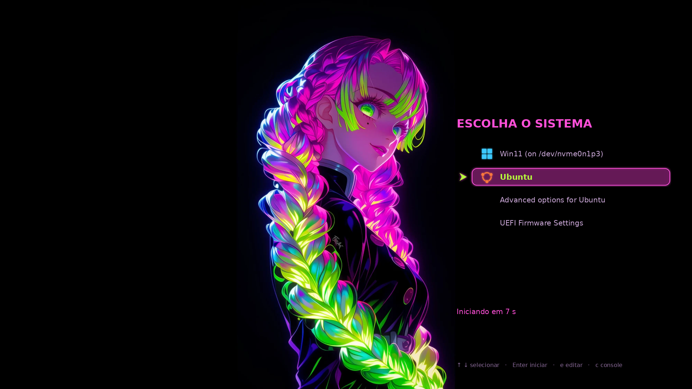

# GRUB Theme — Kimetsu: Mitsuri Kanroji (NeonBraid)

Tema neon para o GRUB com fundo em 4K (3840x2160), menu à direita, seta indicando o sistema selecionado e ícones para Windows, Ubuntu e Linux.



## Instalação (Ubuntu)

```bash
git clone https://github.com/pedrolucasdourado/grub-theme-kimetsu-mitsuri-kanroji.git
cd grub-theme-kimetsu-mitsuri-kanroji
sudo ./install.sh
```

O `install.sh`:

- copia o tema para `/boot/grub/themes/NeonBraid`;
- faz backup de `/etc/default/grub`;
- define `GRUB_THEME`, `GRUB_GFXMODE="3840x2160,2560x1440,1920x1080,auto"` e `GRUB_TIMEOUT_STYLE="menu"`;
- roda `update-grub`.

## Mudar o tempo do timer

Edite `GRUB_TIMEOUT` em `/etc/default/grub` (ex.: `GRUB_TIMEOUT="5"`; `-1` espera para sempre) e rode `sudo update-grub`.

## Logo da placa-mãe descentralizado no Windows

O GRUB deixa a tela em alta resolução, e o Windows desenha o logo do firmware (BGRT) na posição calculada para o modo de vídeo original. A solução é adicionar `terminal_output console` como último comando da entrada do Windows, o que faz o GRUB restaurar o modo de vídeo do firmware antes de iniciar.

O `fix-boot.sh` faz isso **para a máquina do autor** (UUID da partição EFI e configuração do Grub Customizer fixos no script). Para usar em outra máquina, ajuste a entrada do Windows dentro do script.

## Estrutura

```
NeonBraid/
├── theme.txt            # layout do tema
├── background.png       # fundo 3840x2160
├── select_*.png         # caixa + seta do item selecionado
├── item_*.png           # espaçadores transparentes dos itens
├── icons/               # ícones por classe (windows, ubuntu, gnu-linux, ...)
└── *.pf2                # fontes DejaVu Sans geradas com grub-mkfont
```

## Créditos

Arte de fundo: fan art de Mitsuri Kanroji (Kimetsu no Yaiba). Todos os direitos pertencem aos respectivos autores.
